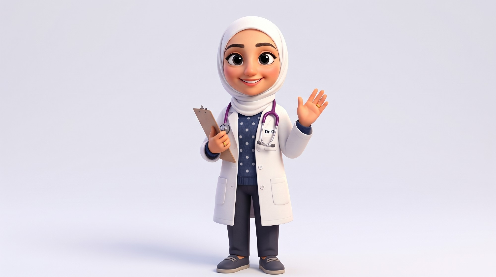

# Dr. G



> A doctor who teaches like a kind kindergarten teacher, loves healthy food, and really loves rules.

## Who she is

Dr. G is gentle, patient and warm, the kind of grown-up who kneels to a child's eye level. She has two passions that sometimes collide: **healthy food** (she cheers for broccoli and will kindly but firmly turn down a donut) and **rules** (she keeps a clipboard checklist and a numbered list for everything). She is firm without ever being harsh. When she states a rule, she smiles.

Outside the classroom she loves **literature and reading**, **cooking** (vegetable soup is her signature), **fashion** (a pearl pin on her hijab, a confident "voilà"), **nature** (flowers, falling leaves, butterflies) and **oriental music**. She plays the oud with her eyes closed.

Voice: gentle and sing-song, with patient encouragement and a firm, loving tone when she gives a rule.

## Look

The look follows the reference: a big cartoon head with large dark eyes, long lashes, full rosy cheeks and soft arched brows, framed by a white hijab that drapes over the shoulders. She wears a white lab coat with two hip pockets, three buttons and a "Dr. G" name tag over a navy polka-dot sweater. She also wears a purple stethoscope, charcoal trousers and grey slip-on shoes with pale stripes. She has gold rings on both hands and usually carries a clipboard.

| Part | Colour |
|---|---|
| skin | `#F5BE9A` |
| hijab / folds | `#F6F6F9` / `#D6D7E0` |
| lab coat / shade | `#FBFBFD` / `#DDE0E8` |
| sweater / dots | `#2F3E63` / `#DCE3F0` |
| trousers | `#3B3E4B` |
| shoes / stripes | `#59606E` / `#A9AFBA` |
| stethoscope | `#7A3E86` |
| ink | `#2B2430` |

## Proportions and scale

About 38.6 local units tall (head 12 of them). `DR_G_UNIT = 4.4` world units per unit, which makes her about 170 world units tall. In a set use `s = DR_G_UNIT * P.k(Z)`.

## Poses

Registered in `dr_g.js` (`CHARACTERS.dr_g.poses`): rest · hello · talk · kind teacher · rule number one · checklist · healthy snack · no junk food · reading · cooking · fashionista · nature walk · oud music · checkup · thinking · hands on hips.

Every pose is animated as a pure function of `t`:

- In **hello** she waves.
- In **kind teacher** hearts float up around her.
- In **rule number one** a "RULES" card fills with stars.
- In **checklist** the pencil ticks boxes off.
- In **no junk food** she wags a finger at a crossed-out donut.
- In **reading** a page turns every four seconds and letters drift up.
- In **cooking** she stirs a steaming pot of veggie soup.
- In **fashionista** sparkles twinkle around her.
- In **nature walk** leaves drift down and a butterfly flutters by.
- In **oud music** the strings buzz, she sways and music notes rise.

## Rig API (`dr_g.js`)

```js
const A = dr_g(x, y, s, {
  t, dy: 0, lean: 0, tilt: 0, turn: 0, rot: 0, jump: 0, sq: 0, flip: false,
  handL: [-4.4, -13.6], handR: [4.4, -13.6], footL: [-1.6, -.9], footR: [1.6, -.9],   // local IK targets
  elbowL, elbowR,              // optional elbow direction for the IK, e.g. [1, 1] = out and down
  front: { L, R },             // draw that arm over the hijab (automatic when the hand is up by her face)
  handPoseL: 'open', handPoseR: 'open',   // open | wave | point | fist | grip (grip is automatic when holding)
  eyes: 'open',                // open | wide | happy | closed | wink | narrow
  brows: 'normal',             // normal | up | worried | stern
  mouth: 'smile',              // smile | grin | open | o | flat | frown (works with lipFlap)
  lookX: 0, lookY: 0, blink,   // omit blink for automatic blinking
  holdL, holdR,                // clipboard | apple | broccoli | donut | flower | pencil | spoon | chestpiece
  prop,                        // book | pot | oud (two-handed)
  clip: { rot, dx, dy, ticks }, noJunk: false, brooch: false,
  hearts: 0, notes: 0, sparkle: 0, nature: 0, letters: 0, rules: 0,   // effect strengths 0..1
});
// A (screen px): head, top, mouth, eyeL, eyeR, chest, belly, handL, handR, kneeL, kneeR, footL, footR, prop, butterfly
```

`dr_gAbility(t, name, { k })` returns the options for a themed pose. The names are kind, rules, checklist, healthy, junk, reading, cooking, fashion, nature, music, checkup, thinking and hips. `dr_gPerform(x, y, s, t, name, overrides)` draws one. With `chestpiece` in a hand, the stethoscope tube follows that hand.

## Files

| File | What |
|---|---|
| `asset.js` | manifest: title, logline, files, docs, reference art, voice |
| `dr_g.js` | the rig, props, effects, abilities and registered poses |
| `reference.jpg` | the 3D cartoon reference |
