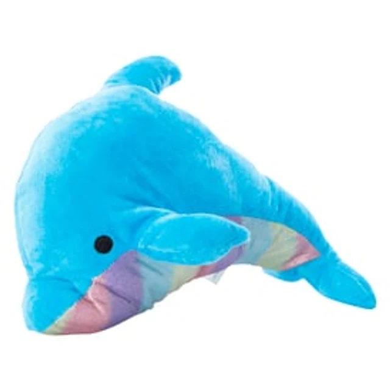

# Neptune



> A plush blue dolphin with a rainbow-striped belly who calls himself "King Neptune". He is not a king. He is hilarious, kind, and has ultra-awesome water powers.

## Who he is

Neptune is a big, bright-blue plush dolphin who introduces himself as ***KING** Neptune, Ruler of All the Seven Seas (and the Bathtub)*. Nobody crowned him. He made the crown himself, it's a bit too big, and it wobbles whenever he gets excited. Insist that he's not really a king and he gets flustered for about one second, then has a comeback ready.

- **Funny:** he cracks jokes nonstop and laughs at his own jokes before he gets to the punchline. He loves puns, especially sea puns ("Water you looking at?", "That's *fin*-tastic!", "Let minnow if you need help!").
- **Kind:** under the bluster he is the gentlest one in the room. He shares, he cheers people up, and he uses his powers to help, never to show off. (Fine, sometimes to show off a little.)
- **Ultra-awesome powers:** when he raises his trident the room glows sea-blue, a ring of water orbits him, bubbles rise, his eyes shine, and rainbow lightning crackles between the prongs. He can fire a rainbow water blast (`neptuneBlast`) that splashes into a ring of coloured droplets.
- **Tells:** a smug half-lidded look and a nose-up tilt when he's being "royal"; a wink when he's about to tell a joke; his crown slides sideways when somebody calls his bluff.
- **Catchphrases:** *"Bow before KING Neptune!… Okay, you don't have to bow."* · *"By the power of the seven seas!"* · *"That's fin-tastic!"*
- **With the cast:** he and Princess Pearl are both plush dolphins, which makes him a natural (self-appointed) rival-slash-royal-cousin. She has a real throne. He has a starfish on his crown.

## Look

A plush toy, like the reference: a soft velvet dolphin with a long rounded beak and an arched leaping silhouette.
- **Body:** bright sky-blue velvet. It is lighter along the back with a sheen on the melon (forehead), darker underneath, with fur flecks and a slightly fuzzy edge.
- **Belly:** the satin rainbow stripes from the photo (lavender, pink, peach, yellow, mint, pale blue) run diagonally from his chin to his tail stock, with a satin shine and the occasional glint.
- **Eye:** a glossy black bead eye with highlights, just above the corner of a long dolphin smile.
- **Fins:** blue dorsal fin, flippers and flukes.
- **Crown (his own invention):** a gold three-point crown with pearl tips and an orange starfish stuck on the front. It sits crooked and wobbles.
- **Trident (optional):** a gold toy trident with a sea-glass gem. With power on, it glows and crackles.

| Part | Colour |
|---|---|
| Body | blue `#2EB2EE` · light `#7BD6FA` · dark `#1786C9` |
| Belly stripes | lavender `#C9B2EE` · pink `#F4A8C8` · peach `#FBC6A0` · yellow `#FBE79B` · mint `#B4EBC8` · sky `#A8DDF2` |
| Eye / lid / blush | bead `#11141C` · lid `#5CC4F2` · blush `#F48DB0` |
| Mouth | inside `#7A2440` · tongue `#F07F9C` |
| Crown / trident | gold `#F2C440` / `#B98A22` / `#FFE9A0` · starfish `#FF8A5C` |
| Powers | water `#7FE3FF` · glow `#BDF4FF` |
| Ink (outlines) | deep navy `#1E3657` |

## Proportions and scale

Like Pearl, he is built along a bendable **spine** (tail base → nose) with a thickness profile: a thin tail stock, a deep chest, a round melon, a forehead crease and then a long beak.
- He is about 23 units nose to tail lying flat, and about 19 units tall sitting up on his tail.
- `NT_UNIT = 10`, so sitting up he is about 190 world units tall, a little taller than Pearl and Fester.
- `(x, y)` is the **surface point under his middle**; the rig centres his body (including the flukes) on it.
- He faces right by default. Pass `flip: true` to face left, as in the photo.

## Poses

Registered in `neptune.js` (`CHARACTERS.neptune.poses`) and shown in the studio:
leap (photo) · sitting · swimming · King Neptune! · talk · laugh · wink · flex · kind · oops (not a king) · ULTRA POWER · turn around.

## Rig API (`neptune.js`)

```js
const A = neptune(x, y, s, {
  // body
  sit,                      // 0 flat … 1 upright on his tail
  arch,                     // leap hump (+ = back up, nose and tail down), as in the photo
  swim,                     // 0..1 travelling body wave (animate with t)
  headTilt,                 // + = nose up (royal, laughing)
  wag,                      // fluke flick
  rot, sq, dy, breathe,
  flip,                     // true = faces LEFT
  turn,                     // 1 → −1 animates a turn-around
  // flippers
  flipNear, flipFar,        // angle offsets from resting
  point, pointAng,          // swing the near flipper out to point at a world angle
  flex,                     // 0..1 curls the near flipper up into a "look at these muscles" pose
  // face
  eyes,                     // open | happy | closed | wide | sparkle | wink | smug | glow
  lookX, lookY, blink,      // blink is automatic unless given
  brows,                    // normal | up | smug | angry | worried
  mouth,                    // smile | grin | laugh | open | o | flat | smirk | frown
  blush,                    // off by default
  // royal props
  crown,                    // default true; false takes it off
  crownTilt, crownLift,
  trident,                  // true: the trident in his near flipper
  tridentAng,               // world angle of the shaft (default −1.3, nearly upright)
  // powers + extras
  power,                    // 0..1: aura, orbiting water ring, bubbles, glowing eyes (when eyes is unset), crackling trident
  emote, emoteK,            // '?' | '!' | 'sweat' | 'heart' | 'music'
});
// A (screen px): head (the eye), mouth, nose, crown, flipper (near tip), belly, tridentTip (with trident)

neptuneBlast(x0, y0, x1, y1, k, t, w);   // rainbow water beam, e.g. from A.tridentTip to a target, k 0..1 over the move
```

Use `measure(() => neptune(...))` to get his anchors (e.g. for a speech bubble or a blast origin) without painting him twice. Ramp `power` up over about half a second; don't snap it on.

## Voice

`asset.js` gives him a `bouncy` voice at 205 Hz, deeper than Fester's, for a big, goofy, booming announcer who keeps cracking himself up.

## Files

| File | What |
|---|---|
| `asset.js` | manifest: title, logline, files, docs, reference art, voice |
| `neptune.js` | the rig, his crown, trident and powers, `neptuneBlast`, registered poses |
| `reference.webp` | reference photo (the plush we match) |

## Fighting poses

The asset manifest loads [the shared fighting pose library](../fighting-poses.js) after this rig. In the studio, select a `fight:` pose to preview its looping animation. Existing scene poses remain available.

See [the fighting pose guide](../FIGHTING.md) for the move list, character-specific specials, timing, and the drawing API for either facing direction.
