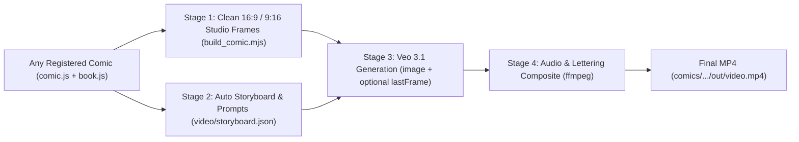

# Action Plan: General Comic-to-Video Workflow (Studio JS → Veo 3.1)

> Adapts **Pipeline 1** from [GEMINI_VIDEO_TO_VIDEO_REPORT.md](GEMINI_VIDEO_TO_VIDEO_REPORT.md) into a reusable, general-purpose workflow that converts **any registered comic** (`comics/<book_id>/<comic_id>/`) directly into an animated MP4 using **Studio JavaScript-rendered frames** and **Veo 3.1** — skipping the Nano Banana 2.1 keyframe restyling stage entirely.

---

## 1. End-to-End Architecture



### Key Differences from Original Pipeline 1
| Aspect | Original Pipeline 1 (Scene-to-Video) | New General Comic-to-Video Workflow |
|---|---|---|
| **Source** | Animated scene (`render.mjs`) | **Any registered comic** (`comic.js` + `book.js` + `asset.js`) |
| **Keyframe Art** | Studio render → Nano Banana 2.1 restyle | **Direct Studio JS canvas PNGs** (bubble-free, borderless) |
| **Aspect Ratio** | Already `16:9` (`1920×1080`) | Comic panels are arbitrary grids → **recomposed natively to `16:9` or `9:16`** via `panel.draw(vw, vh)` |
| **Shot Continuity** | Continuous beats inside a scene | Mix of **continuous panel transitions** (`image` + `lastFrame`) and **hard-cut living beats** (`image` only) |
| **API Cost** | 2 Nano Banana calls + 1 Veo call per beat | **1 Veo call per shot** (zero image-gen calls) |

---

## 2. Core Technical Challenges & Design Decisions

### A. Aspect-Ratio Recomposition (`16:9` / `9:16`) Without Cropping or Distortion
Veo 3.1 strictly requires **`16:9`** (landscape) or **`9:16`** (portrait) inputs/outputs, whereas comic panels in [`engine/comic.js`](../engine/comic.js) have arbitrary grid sizes (e.g., ~`520×630` in a 3×3 Letter page).

- **Why naive scaling fails:** Stretching distorts characters; center-cropping cuts off heads/feet; letterbox black bars confuse Veo's diffusion model.
- **Why Studio JS wins:** Every panel draws procedurally via `panel.draw(pw, ph)`, using fractional positioning (`pw * 0.62, ph * 0.70`), while character scales (`s = 14..25`) are tuned to the panel's native height (`ph`).
- **Solution — Height-Matched Virtual Recomposition (`--framing=recompose`, default):**
  1. Given a panel's native layout `(pw, ph)` and target aspect `targetAr` (`16/9` or `9/16`):
     - If `pw / ph < targetAr` (panel is narrower than 16:9): set `vw = Math.round(ph * targetAr)`, `vh = ph` so character pixel scale stays 100% faithful to `ph` while backgrounds (`drawBedroomBg`, `drawKitchenBg`, `drawLocationInPanel`) fill the wider frame edge-to-edge.
     - If `pw / ph > targetAr` (panel is wider than target): set `vw = pw`, `vh = Math.round(pw / targetAr)`.
  2. Call `panel.draw(vw, vh)` with `lettering: false` and `border: false`, then scale cleanly to `1280×720` (for `720p`) or `1920×1080` (for `1080p`) — or `720×1280` / `1080×1920` for `9:16`.
  3. Provide fallback framing modes (`--framing=pad` with edge-matched backdrop fill, or `--framing=crop`) for any future panel with hardcoded pixel coordinates that don't widen cleanly, plus a **contact sheet preview** (`video/frames_sheet.jpg`) to visually verify every frame before calling Veo.

### B. Panel-to-Shot Grouping (Interpolation vs. Hard Cuts)
Blindly interpolating every adjacent pair `(Panel N → Panel N+1)` fails across scene cuts (e.g., bedroom → hallway → kitchen morphs walls into stoves).

- **Two Veo 3.1 shot types:**
  1. **`interpolate` (`image = Panel N`, `lastFrame = Panel N+1`, `durationSeconds: 8`)**: Used when consecutive panels share the same `location` and overlapping `cast` (e.g., `p2_asleep` → `p2_yawn` in `bedroom`, or `p2_whats_for_breakfast` → `p2_pancakes` → `p2_flip_toss` in `kitchen`).
  2. **`single` (`image = Panel N`, no `lastFrame`, `durationSeconds: 4 | 6 | 8`)**: Used for standalone beats, location changes, bio/title cards, or the final panel before a hard cut.
- **Automatic Heuristic + Editable Storyboard (`video/storyboard.json`):**
  - Read panel metadata from `extractPageScript()` in [`engine/comic.js`](../engine/comic.js) (`id`, `cast`, `location`, `prompt`, `captions`, `bubbles`, `sfx`).
  - Auto-group consecutive panels with matching `location` (when non-empty) and overlapping `cast` into chained `interpolate` transitions; insert hard cuts (`single`) at location changes, page-1 bio/title panels, or explicit `video: { cut: true }` hints.
  - Write the plan to `comics/<book_id>/<comic_id>/video/storyboard.json` so the author can review/edit shot pairings, durations (`4 | 6 | 8`), prompts, or skip pages before spending Veo quota.

### C. Preserving the 2D Studio Look Without Nano Banana 2.1
Feeding crisp 2D canvas drawings directly into Veo 3.1 can cause Veo to drift toward 3D CGI or photorealism unless explicitly anchored.

- **2D Studio Style Lock (injected into every Veo prompt):**
  - Explicit directive: *"2D hand-drawn cartoon animation strictly preserving the exact flat-shaded vector art style, warm dark-brown ink outlines, pastel color palette, and character designs of the provided frame(s). No 3D CGI, no photorealism, no live-action lighting, no on-screen text or speech bubbles."*
  - Append compact character identity hints from `book.js` `castBible` (e.g., Eve Earth = sky-blue round planet plushie; Eve's Dad = larger blue globe plushie with wavy squiggly mustache) and `invariants` (e.g., *"pancakes have no faces"*) so Veo keeps character geometry stable during motion.
  - Optionally support `--enrich-prompts` (a single fast Gemini text call reading `README.md` + panel scripts to polish transition motion/camera descriptions in `storyboard.json`).

### D. Audio & Comic Lettering Strategy
Because clean frames have **no baked-in speech bubbles or text** (preventing garbled diffusion typography):

- **Audio modes (`--audio=veo|tts|mute`, default `veo`):**
  - `veo` *(default for fast iteration)*: Embed dialogue lines + speaker voice cues + SFX directly in the Veo 3.1 prompt so Veo generates synchronized voices, lip motion, and foley natively.
  - `tts` *(recommended for multi-page comics with recurring cast)*: Prompt Veo for ambient/foley-only motion (no speech), synthesize deterministic per-character voices via Gemini TTS (reusing the pattern in [`scripts/tts_gemini.mjs`](../scripts/tts_gemini.mjs) with a `voiceMap` per speaker in `book.js` / `storyboard.json`), and mix with `ffmpeg`.
  - `mute`: Silent video clips for external editing.
- **Text overlays (`--overlays=none|subtitles|lettering`, default `subtitles`):**
  - `none`: Pure full-bleed animation.
  - `subtitles`: Clean burn-in captions / dialogue subtitles via `ffmpeg` (`.srt` / `.ass` generated from `storyboard.json`).
  - `lettering`: Render transparent-background PNGs using `drawPanelLettering()` in [`engine/comic.js`](../engine/comic.js) (or timed fade-in bubbles/SFX) and composite over the Veo clip with `ffmpeg`.

---

## 3. Phased Implementation Plan

### Phase 1 — Clean 16:9 / 9:16 Studio Frame & Overlay Exporter ✅
**Files modified:**
- [x] [`engine/comic.js`](../engine/comic.js):
  - Extended `renderComicPage()` (`opts.panelIndex != null`) with `computeVideoCanvasSize()`, `targetWidth`, `targetHeight`, `framing` (`'native' | 'recompose' | 'pad' | 'crop'`), and `transparentLetteringOnly: true`, plus `video` hints in `extractPageScript()`.
- [x] [`studio/studio.js`](../studio/studio.js):
  - Forwarded comic/book `video` defaults in `window.comicInfo()` and exposed video frame rendering options through `window.renderComicPageTo()`.
- [x] [`scripts/build_comic.mjs`](../scripts/build_comic.mjs):
  - Added `--video-frames`, `--aspect=16:9|9:16`, `--resolution=720p|1080p`, `--framing=recompose|pad|crop`, `--overlays`, `videoDimensions()`, and contact-sheet generation (`video/frames_sheet.jpg`).
  - Exports clean PNGs into `comics/<book_id>/<comic_id>/video/frames/<pageId>_<panelId>.png`.

### Phase 2 — Storyboard Planner & Prompt Builder ✅
**New module:** [`scripts/comic_video_plan.mjs`](../scripts/comic_video_plan.mjs) (imported by CLI & tests)
- [x] Reads `window.comicInfo()` + `book.js` (`castBible`, `invariants`, `style`).
- [x] Groups panels into ordered shots (`single` vs. `interpolate`) using `location`, scene/caption heuristics, `cast`, bio/title detection, and per-panel `video` hints.
- [x] Builds Veo 3.1 prompts combining:
  1. 2D Studio Style Lock (`STYLE_LOCK_2D`)
  2. Active cast descriptions + invariants (filtered to cast in the shot)
  3. Action/transition description from Panel `N` (and Panel `N+1` if interpolating)
  4. Camera & native Veo audio/dialogue cues (deduplicated across chained shots; supports `--audio=veo|mute`)
- [x] Outputs human-editable `comics/<book_id>/<comic_id>/video/storyboard.json`.
- [x] Supports `--enrich-prompts` (optional Gemini Flash pass to refine motion transitions between panels) and `generateSrtFromStoryboard()`.

### Phase 3 — Veo 3.1 REST Client, Resumable Polling & SHA-1 Caching ✅
**New CLI script:** [`scripts/comic_to_video.mjs`](../scripts/comic_to_video.mjs) (mirrors [`scripts/illustrate_comic.mjs`](../scripts/illustrate_comic.mjs), **zero new npm dependencies**)

- [x] **REST API integration (native `fetch` + `GEMINI_API_KEY` from env/`.env`):**
  - **Live Gemini API Update (Nov 2026):** `veo-3.1-*-preview` on `generativelanguage.googleapis.com` was retired Oct 22, 2026 in favor of **`gemini-omni-1.2-flash`** via the **Interactions API** (`POST https://generativelanguage.googleapis.com/v1beta/interactions` with `background: true`, `response_modalities: ["video"]`, `generation_config.video_config.task: "image_to_video"`, and `response_format: { type: "video", aspect_ratio, duration, resolution }`). `scripts/comic_to_video.mjs` defaults to `gemini-omni-1.2-flash` via `/v1beta/interactions` and automatically routes `--model=veo-*` to `:predictLongRunning`.
  - Polls `GET /v1beta/interactions/${interactionId}` (or `/v1beta/${operationName}` for Veo) until complete, then saves inline base64 or downloads URI bytes with `x-goog-api-key`.
- [x] **Resumable Operation Tracking & SHA-1 Take Cache:**
  - Hashes `model + prompt + aspectRatio + resolution + durationSeconds + firstFrameBytes + lastFrameBytes` → 12-char SHA-1.
  - Stores takes in `comics/<book_id>/<comic_id>/video/takes/<shotId>_<hash8>.mp4` and metadata in `video/index.json`.
  - **Saves in-flight `operationName` to `video/index.json` immediately after `predictLongRunning` returns** so interrupted runs resume polling instead of re-billing.
  - Supports `--approve=<take_id>` to promote any historical take to `video/clips/<shotId>.mp4`.

### Phase 4 — `ffmpeg` Assembly, Transitions, Audio & Overlays ✅
Inside [`scripts/comic_to_video.mjs`](../scripts/comic_to_video.mjs) (`assembleComicVideo`, reusing existing `ffmpeg-static`):
- [x] Normalizes all approved shot clips to matching codec/fps/pixel format (`libx264`, `yuv420p`, `24fps`, `48kHz` stereo AAC with automatic `anullsrc` fallback for silent clips).
- [x] Trims boundary frames (`0.084s` / ~2 frames at 24fps) on chained `interpolate` clips where Shot `k`'s `lastFrame` equals Shot `k+1`'s `image` to eliminate splice stutter.
- [x] Supports `--overlays=subtitles` (default, writing `out/video.srt` and rendering via `--subtitles=burn` or `--subtitles=soft` `mov_text`), `--overlays=lettering` (transparent PNG composite from Phase 1), and `--overlays=none`.
- [x] Outputs final video to `comics/<book_id>/<comic_id>/out/video.mp4` (or `out/video_page-XX.mp4` for single-page builds).

### Phase 5 — CLI Ergonomics, Git Rules, Tests, Skill & Optional Studio UI ✅
- [x] **[`package.json`](../package.json):** Added `"comic:video": "node scripts/comic_to_video.mjs"`.
- [x] **[`.gitignore`](../.gitignore):** Ignored `comics/**/video/frames/`, `overlays/`, `takes/`, `clips/`, `index.json`, `frames_sheet*.jpg`, `.assemble_tmp/`, and `out/*.srt`; kept `comics/**/video/storyboard.json` trackable.
- [x] **CLI Usage:**
  ```sh
  # 1. Zero-cost plan + export 16:9 studio frames + contact sheet for visual review
  npm run comic:video -- ice_skating --plan

  # 2. Zero-cost dry-run inspecting Veo payloads, prompts & estimated duration/clips
  npm run comic:video -- ice_skating --dry-run

  # 3. Prototype a single shot with fast Veo model
  npm run comic:video -- ice_skating --shot=1

  # 4. Generate a single page or full comic, then assemble final MP4
  npm run comic:video -- the_adventure --page=2
  npm run comic:video -- ice_skating --assemble-only

  # 5. Re-roll one shot at high quality & promote a take
  npm run comic:video -- ice_skating --shot=3 --quality --force
  npm run comic:video -- ice_skating --shot=3 --approve=v1
  ```
- [x] **Automated Verification ([`scripts/test-comic-video.mjs`](../scripts/test-comic-video.mjs)):**
  - Offline test suite (zero API cost) passing for both existing comics (`ice_skating` and `the_adventure`):
    - 16:9 and 9:16 Studio frame export dimensions & non-blank pixels
    - Storyboard auto-grouping (cut detection across locations vs. same-location interpolation)
    - Prompt construction (2D style lock, castBible routing, no leaked bubble text when clean)
    - Veo REST payload schema validation (`lastFrame` inside `instances[0]`, `durationSeconds` constraints)
    - SHA-1 cache hashing & operation URI parsing
    - `ffmpeg` assembly pipeline (normalization, chained trim, burned & soft subtitles, lettering overlay) using synthetic test clips
- [x] **Agent Skill ([`.agents/skills/comic-to-video/SKILL.md`](../.agents/skills/comic-to-video/SKILL.md)):** Documented the intake → `--plan` visual review → single-shot pilot → full render workflow.
- [ ] **Optional Phase 5b (Studio UI Integration — deferred per Decision #3):** Add `/api/comic-video` to [`serve.mjs`](../serve.mjs) and a **"Video"** tab/player in [`studio.html`](../studio.html) + [`studio/studio.js`](../studio/studio.js) to preview `out/video.mp4` and per-shot takes directly in the browser.

---

## 4. Sizing & Pilot Strategy

| Existing Comic | Pages / Panels | Est. Veo Clips | Est. Final Length | Recommended Role |
|---|---|---|---|---|
| `ice_skating` (`sami_and_jenna`) | 1 page · 9 panels | ~5–8 clips | ~35–55s | **Best full end-to-end pilot** (small, fast, validates all stages) |
| `the_adventure` (`palm_pals_adventures`) | 8 pages · ~60 panels | ~35–50 clips | ~4–6 min | **Best 1-page pilot** (`--page=2`: bedroom wake-up → kitchen pancakes, ~6 clips) |

> [!TIP]
> Always run `--plan` first and inspect `video/frames_sheet.jpg`, then generate **1–2 shots** with `veo-3.1-fast-generate-preview` (`720p`) to verify 2D style fidelity and motion before generating an entire comic.

---

## 5. Open Decisions Before Implementation

1. **Default Audio Mode:** Start with **Veo 3.1 native audio** (`--audio=veo`) for simplicity, or build **Gemini TTS per-speaker voice tracks** (`--audio=tts`) in the very first milestone?
Start with Veo native audio

2. **Default Text Overlays:** Should the default output be **clean animation + burned/soft subtitles** (`--overlays=subtitles`), **no text overlays** (`--overlays=none`), or **timed comic lettering overlays** (`--overlays=lettering`)?
clean animation + burned/soft subtitles

3. **Studio UI Scope:** Include CLI + tests + skill first (Phases 1–5), or also include the `studio.html` Video tab & `/api/comic-video` endpoint (Phase 5b) in the initial build?
Include CLI + tests + skill first (Phases 1–5)

4. **First Pilot Target:** Validate on `ice_skating` (1 page, 9 panels) or Page 2 of `the_adventure` (`palm_pals_adventures`)?
Agree
