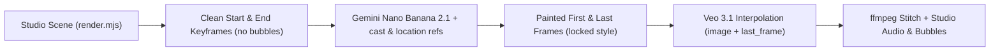
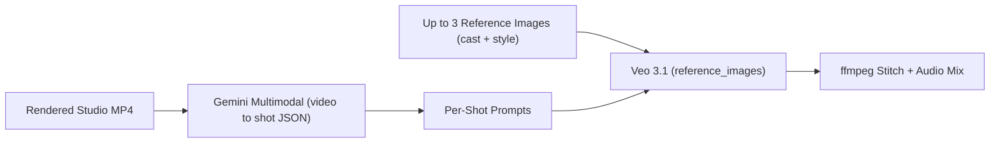

# Gemini & Veo Video-to-Video Report

> Research summary and implementation options for transforming rendered Safadi Animation Studio videos (such as `scene77_palm_pals_adventure`) into AI-illustrated video using Google's Gemini API and Veo 3.1.

## Executive Summary

**Can Gemini take an MP4 video as input and directly output a restyled MP4 video in one step?**  
**No — not directly.** The Gemini API separates video *understanding* from video *generation* across two model families:

| Model Family | Video Input | Output | Role in a Video-to-Video Pipeline |
|---|---|---|---|
| **Gemini** (multimodal LLM) | Arbitrary MP4s | Text, JSON, or images (e.g., Nano Banana 2.1) | Watch a rendered studio video, extract shot-by-shot action/camera prompts, or restyle individual keyframes |
| **Veo (`veo-3.1`)** | Veo-generated clips (for extension only), or **images** (first/last frames or up to 3 reference images) | 4–8s video clips (720p/1080p) | Animate painted keyframes or generate clips guided by character/style reference images |

Because Veo's native `video` input is limited to **extending clips previously generated by Veo**, transforming a studio-rendered MP4 requires a **two-stage pipeline** that pairs our existing renderer (`render.mjs`), Gemini Nano Banana 2.1 (`scripts/illustrate_comic.mjs` conventions), Veo 3.1, and `ffmpeg`.

---

## Veo 3.1 Capabilities & Key Constraints

1. **Short clip duration per call:** Each generation produces **4, 6, or 8 seconds** of video (e.g., `16:9` at 720p/1080p).
2. **Video extension rules:**
   - Only works natively on clips **previously generated by Veo** (not arbitrary external MP4 uploads).
   - Each extension adds roughly **7 seconds** of continuation (chainable up to ~20 extensions / ~148 seconds max).
3. **First-and-last-frame interpolation:** You can pass a starting frame (`image`) and ending frame (`last_frame`) along with a motion prompt to generate a smooth animated clip bridging the two frames.
4. **Reference images ("Ingredients to Video"):** You can supply up to **3 reference images** (`reference_images`) to preserve character, prop, or style consistency across generated shots.
5. **Mutual-exclusion constraint:** In Veo 3.1, **`reference_images` cannot be combined with `image` / `last_frame` in the same request**. You must choose either frame interpolation *or* multi-image references per call.
6. **Asynchronous execution & quotas:** `generate_videos()` returns a long-running operation that must be polled until complete. Rate limits and per-second generation costs add up quickly across long videos, so prototyping on a single shot first is strongly recommended.

---

## Two Practical Pipelines for Safadi Animation Studio

### Pipeline 1: Keyframe Restyle + Veo 3.1 Interpolation *(Recommended)*

This mirrors how `scripts/illustrate_comic.mjs` already locks character identity for *Palm Pals Adventures*, and works cleanly around Veo's mutual-exclusion rule by baking character/style consistency into the painted keyframes first.



**Steps:**
1. **Export clean keyframes:** For each 5–8s beat/shot in a scene, render clean start and end PNGs (hiding speech bubbles and SFX overlays so Veo doesn't distort text).
2. **Restyle keyframes with Nano Banana 2.1:** Pass each keyframe alongside the cast bible & location references (e.g., `comics/palm_pals_adventures/style_refs/cast_sheet.png`, `char_eve.png`, `char_zelie.png`, `char_eve_dad.png`, `char_zelie_papa.png`) so character proportions, colors, and signature traits (like the Dads' squiggly mustaches) stay 100% consistent.
3. **Interpolate motion with Veo 3.1:** Call `generate_videos` with `image = painted_start`, `last_frame = painted_end`, and a concise action/camera prompt matching the studio shot.
4. **Composite & assemble with `ffmpeg`:** Concatenate all shot clips, lay back the studio's deterministic soundtrack & character voices (`studio/music.js`), and optionally composite crisp vector speech bubbles and captions on top.

**Pros:**
- Highest visual and character consistency (reuses the proven `castBible` + `invariants` architecture).
- Exact pacing and shot boundaries stay aligned with the studio's dialogue audio timeline.
- Clean typography — bubbles and SFX are never garbled by video diffusion.

**Cons:**
- Requires two API stages per shot (2 image calls + 1 Veo call per ~6–8s beat).
- Fast comedic gags or multi-beat 15–19s shots need to be split into smaller 5–8s sub-beats so Veo doesn't drift mid-shot.

---

### Pipeline 2: Gemini Video Analysis → Veo 3.1 Reference-to-Video

If you want a looser, more re-imagined cinematic adaptation rather than strict frame-to-frame alignment:



**Steps:**
1. **Upload the studio MP4 to Gemini:** Ask Gemini to watch the video and emit a structured JSON shot list (timestamps, camera moves, character expressions, and concise visual prompts for each 6–8s segment).
2. **Generate shots with Veo 3.1:** For each shot, pass the generated prompt plus up to **3 `reference_images`** (e.g., `cast_sheet.png`, `storybook_anchor_1.png`, and a location ref).
3. **Assemble with `ffmpeg`:** Trim/align clips to the original dialogue timings and mux the soundtrack.

**Pros:**
- Simpler workflow (no separate keyframe restyling step).
- Good for exploring fresh camera angles or freer storybook motion.

**Cons:**
- Less predictable composition and timing; characters/props are more likely to drift across cuts.
- Limited to 3 reference images per call (harder for 4-character shots like the breakfast table or entryway reveal).

---

## Sizing Estimate for a 3-Minute Scene (`scene77_palm_pals_adventure`)

| Metric | Single Test Shot (6–8s) | Full 3-Minute Scene (180s) |
|---|---|---|
| Sub-beats (5–8s each) | 1 clip | ~25–35 clips |
| Pipeline 1 Nano Banana calls | 2 images | ~50–70 images (fewer if consecutive beats share end→start frames) |
| Veo 3.1 calls | 1 video | ~25–35 videos |
| Recommended first step | Prototype 1–2 iconic shots (e.g., pancake flip or blue portal) | Scale only after validating style, motion, and cost |

> **Tip on shared keyframes:** Within a continuous shot (no hard cut), Beat *N*'s painted `last_frame` can be reused directly as Beat *N+1*'s `image` (`first_frame`), cutting Nano Banana calls nearly in half and guaranteeing seamless visual continuity across sub-beats.

---

## Suggested Implementation Blueprint (`scripts/illustrate_scene.mjs`)

If we decide to build this into the studio, we can mirror `scripts/illustrate_comic.mjs`:

- **CLI interface:**
  ```bash
  node scripts/illustrate_scene.mjs scene77_palm_pals_adventure --shot=3 --dry-run
  node scripts/illustrate_scene.mjs scene77_palm_pals_adventure --shot=3 --pipeline=keyframes
  ```
- **Caching & takes:** SHA-1 hash each shot's clean keyframes + prompt + reference images into `scenes/<series>/<id>/illustrated/takes/`, supporting `--force` and `--approve=<take_id>` so reruns never waste Veo quota.
- **Clean-plate render flag:** Add a lightweight `--no-bubbles` (or `?bubbles=0`) option to `render.mjs` so keyframes export without baked-in speech bubbles, allowing crisp vector lettering to be re-applied cleanly in post.
- **Audio & assembly:** Reuse the studio's existing `ffmpeg-static` dependency to stitch approved shot MP4s and mux the synthesized scene soundtrack (`studio/music.js`).
